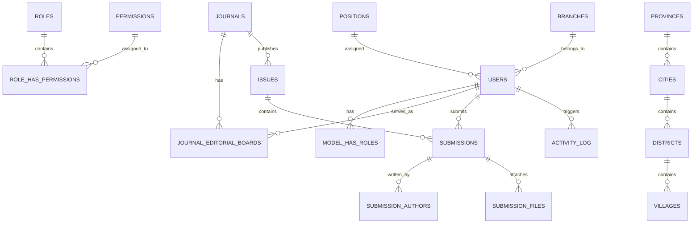

# 📚 Dokumentasi Sistem Lengkap: Laravel 12 Dashboard Template (Ignite)

Dokumentasi arsitektur, modul aplikasi, skema data, infrastruktur, dan panduan pengembangan untuk **Laravel 12 Dashboard Template (Ignite)**. Dokumen induk terpadu (9 dokumentasi SDLC & alur editorial) tersedia di [ignite-complete-master-documentation.html](file:///Users/daengdeni/Development/.ysds/.ignite/ignite-implementation-guide/ignite-complete-master-documentation.html) dan [ignite-complete-master-documentation.pdf](file:///Users/daengdeni/Development/.ysds/.ignite/ignite-implementation-guide/ignite-complete-master-documentation.pdf). Spesifikasi kebutuhan fungsional & alur produk lengkap dapat dilihat di [PRD.md](file:///Users/daengdeni/Development/.ysds/.ignite/PRD.md), serta buku panduan operasional pengguna & SOP sistem di [ignite-user-manual-sop.html](file:///Users/daengdeni/Development/.ysds/.ignite/ignite-implementation-guide/ignite-user-manual-sop.html).

---

## 📑 Daftar Isi
1. [Ringkasan & Tech Stack](#1-ringkasan--tech-stack)
2. [Arsitektur Sistem (Modular Architecture)](#2-arsitektur-sistem-modular-architecture)
3. [Daftar Modul & Fitur](#3-daftar-modul--fitur)
4. [Skema Basis Data & Relasi Entitas](#4-skema-basis-data--relasi-entitas)
5. [Keamanan & Autentikasi](#5-keamanan--autentikasi)
6. [Frontend & UI Framework](#6-frontend--ui-framework)
7. [Infrastruktur Docker & Observabilitas](#7-infrastruktur-docker--observabilitas)
8. [Panduan Instalasi & Deployment](#8-panduan-instalasi--deployment)
9. [Standar & Konvensi Pengembangan](#9-standar--konvensi-pengembangan)

---

## 1. Ringkasan & Tech Stack

Aplikasi ini adalah template sistem enterprise modern berbasis **Laravel 12** yang mengadopsi pola **Modular Architecture (HMVC)** menggunakan `nwidart/laravel-modules`. Dirancang untuk skalabilitas, kemudahan integrasi multi-database (MySQL / PostgreSQL), dan pemisahan *domain logic* yang bersih.

### 🛠️ Core Technology Stack

| Lapisan | Teknologi / Paket | Deskripsi |
| :--- | :--- | :--- |
| **Backend Framework** | Laravel 12.x (PHP 8.3+) | Modern PHP framework dengan container dependency injection dan Eloquent ORM. |
| **Modular Engine** | `nwidart/laravel-modules` v13.0 | Pemisahan kode ke dalam modul independen per domain bisnis. |
| **Authorization** | `spatie/laravel-permission` v8.3 | Role-Based Access Control (RBAC) granular dengan permission dinamis. |
| **Audit & Logging** | `spatie/laravel-activitylog` & `daengdeni/log-reader` | Audit trail otomatis untuk perubahan model dan log viewer terintegrasi. |
| **Excel I/O** | `maatwebsite/excel` v3.1 | Export & import data modular ke format spreadsheet (.xlsx/.csv). |
| **Frontend Styling** | TailwindCSS v4.x + Vite v7.x | Framework utility-first CSS dengan plugin Vite super cepat. |
| **UI Components** | Metronic UI Engine + Alpine.js | Dashboard layout, sidebar navigation, dropdown, dan reactive UI elements. |
| **Charts & Media** | ApexCharts, TinyMCE, Dropzone, Filerobot | Visualisasi grafik, editor WYSIWYG, dan manajemen berkas gambar/dokumen. |
| **Containerization** | Docker & Docker Compose | Multi-container environment (App, Nginx, MySQL, PostgreSQL, Redis, Queue, Scheduler). |
| **Monitoring** | Laravel Telescope & Laravel Pulse | Real-time debugging, query profiling, job queues, dan server health monitoring. |

---

## 2. Arsitektur Sistem (Modular Architecture)

Sistem mengadopsi pendekatan modular di mana setiap fitur bisnis diisolasi dalam direktori `Modules/[NamaModul]`.

```
.ignite/
├── app/                          # Core Laravel Application (Kernel, Providers, Helpers)
├── config/                       # Konfigurasi Global (app, auth, database, modules, etc.)
├── database/                     # Migrasi & Seeder Global (Activity logs, Cache, Notifications)
├── docker/                       # Konfigurasi Docker (Nginx, PHP 8.3, etc.)
├── Modules/                      # Modul Domain Bisnis
│   ├── Authentication/           # Autentikasi, 2FA, Reset Password, UIM
│   ├── Basicdata/                # Master Data (Cabang, Mata Uang, Kalender Libur)
│   ├── Issues/                   # Manajemen Volume & Terbitan Jurnal
│   ├── Journals/                 # Pengaturan Jurnal & Dewan Editor
│   ├── Location/                 # Hirarki Wilayah Indonesia (Prov, Kota, Kec, Kel)
│   ├── Logs/                     # Audit Logs & System Log Viewer
│   ├── Submissions/              # Alur Pengiriman Naskah & Penulis
│   ├── Usermanagement/           # Pengguna, Jabatan, Hak Akses & Role
│   └── Website/                  # CMS Pengaturan Web, Berita & Program
├── public/                       # Web Root & Static Assets
├── resources/                    # Global Views, JS, CSS, & Metronic Theme Engine
├── routes/                       # Web & Console Routes Global
└── storage/                      # Cache, Sessions, & Uploaded Storage
```

### 🧩 Struktur Anatomi Setiap Modul
Setiap modul di bawah `Modules/` memiliki struktur mandiri:
```
Modules/[ModuleName]/
├── app/
│   ├── Classes/                  # Domain Helpers / Custom Classes
│   ├── Exports/                  # Kelas Maatwebsite Export
│   ├── Helpers/                  # Helper functions modular
│   ├── Http/
│   │   ├── Controllers/          # REST & Web Controllers
│   │   └── Requests/             # Form Request Validation
│   ├── Models/                   # Eloquent Models & Traits (SoftDeletes, Userstamps)
│   └── Services/                 # Business Logic & Service Layer
├── config/                       # Konfigurasi spesifik modul
├── database/
│   ├── factories/                # Model Factories untuk testing
│   ├── migrations/               # Skema tabel modul
│   └── seeders/                  # Data awal modul
├── resources/
│   └── views/                    # Blade Templates modul
├── routes/
│   ├── web.php                   # Route Web modul
│   └── api.php                   # Route API modul (opsional)
├── tests/
│   └── Feature/                  # Feature & Unit Tests modul
├── composer.json                 # Metadata & dependensi modul
└── module.json                   # Definisi status & konfigurasi modul
```

---

## 3. Daftar Modul & Fitur

### 🔐 1. Modul `Authentication`
* **Login & Register:** Alur autentikasi aman dengan throttling dan event tracking.
* **Two-Factor Authentication (2FA):** Dukungan TOTP Google Authenticator / QR Code.
* **Password Recovery:** Alur lupa kata sandi dengan token reset terenkripsi.
* **UIM Helper:** Integrasi kelas `Uim` dan utilitas identifikasi user session.

### 👥 2. Modul `Usermanagement`
* **User CRUD:** Manajemen pengguna dengan avatar, status akun, dan filter jabatan.
* **Roles & Permissions:** Manajemen RBAC hierarkis menggunakan Spatie Permission.
* **Positions (Jabatan):** Pengelompokan hierarki jabatan pegawai/pengguna.
* **Data Export:** Export daftar pengguna ke format Excel dengan formatting dinamis.

### 🏢 3. Modul `Basicdata`
* **Branches (Cabang):** Manajemen unit kantor/cabang organisasi.
* **Currencies (Mata Uang):** Pengaturan valuta dan simbol finansial.
* **Holiday Calendars:** Pengaturan kalender libur nasional dan operasional.

### 🗺️ 4. Modul `Location`
* **Indonesian Regional Hierarchy:**
  * `Provinces` (Provinsi)
  * `Cities` (Kota / Kabupaten)
  * `Districts` (Kecamatan)
  * `Villages` (Kelurahan / Desa + Kode Pos)
* **Dynamic Dependent Dropdowns:** Endpoint AJAX untuk pengambilan data berjenjang.
* **Excel Export/Import:** Dukungan export master wilayah per tingkatan.

### 📖 5. Modul `Journals`
* **Journal Master:** Pengaturan jurnal ilmiah, ISSN, e-ISSN, fokus & ruang lingkup.
* **Editorial Board:** Manajemen dewan editor, reviewer, dan penugasan per jurnal.

### 📑 6. Modul `Issues`
* **Issue & Volume Management:** Pembuatan nomor issue/terbitan, tahun, dan volume jurnal.
* **Publishing Status:** Penandaan status draft, scheduled, hingga published.

### 📤 7. Modul `Submissions`
* **Manuscript Management:** Pengiriman naskah, abstrak, kata kunci, dan metadata.
* **Submission Files:** Pengunggahan berkas artikel, supplementary files, dan revisi.
* **Submission Authors:** Multi-author support dengan korespondensi utama.
* **Editor Workflow:** Dashboard editor untuk peninjauan naskah masuk.

### 📋 8. Modul `Logs`
* **Audit Logs:** Riwayat aktivitas pengguna (*who, what, when, model diff*) via Spatie Activity Log.
* **System Logs Viewer:** Antarmuka pemantau berkas `laravel.log` dengan filter tingkat keparahan (*Emergency, Error, Warning, Info*).

### 🌐 9. Modul `Website`
* **Website Settings:** Pengaturan umum situs (nama situs, logo, kontak, media sosial).
* **News & Articles:** Manajemen artikel/berita dengan rich-text editor TinyMCE.
* **Programs & Events:** Publikasi program atau agenda kegiatan.

---

## 4. Skema Basis Data & Relasi Entitas



### 🔑 Trait Bersama Pada Setiap Model
1. **`SoftDeletes`**: Menghapus data secara logis (`deleted_at`) tanpa kehilangan riwayat.
2. **`Userstamps`**: Otomatis mencatat `created_by`, `updated_by`, dan `deleted_by` merujuk ke ID User yang sedang login.
3. **`LogsActivity`**: Menghasilkan log audit secara otomatis pada operasi CRUD.

---

## 5. Keamanan & Autentikasi

* **Hashing & Enkripsi:** Password dienkripsi dengan algoritma `Bcrypt` / `Argon2ID`.
* **Proteksi CSRF & XSS:** Diterapkan di semua rute web dan request sanitization.
* **Rate Limiting (Throttling):** Diterapkan pada rute autentikasi dan API untuk mencegah *brute-force attacks*.
* **Two-Factor Authentication (2FA):** Dukungan kode autentikasi 6-digit sekali pakai (TOTP) berbasis RFC 6238.
* **Granular Middleware Authorization:** Rute dilindungi middleware Spatie `permission:[nama-permission]` atau `role:[nama-role]`.

---

## 6. Frontend & UI Framework

Frontend dibangun dengan arsitektur modern berbobot ringan:
* **Vite + TailwindCSS v4:** Pengemasan aset super cepat dengan *tree-shaking* otomatis.
* **Alpine.js:** Interaktivitas reaktif tanpa beban framework SPA yang berat.
* **Metronic 9 Core Engine:** Komponen UI mencakup:
  * Layout responsif (Sidebar, Header, Breadcrumbs, Footer).
  * Komponen DataTables interaktif.
  * Form Validation canggih dengan feedback visual real-time.
  * Modal dialog, Popover, dan Dropdown menu.
* **Komponen Eksternal:**
  * **ApexCharts:** Visualisasi statistik dan performa.
  * **TinyMCE:** Rich Text Editor untuk konten publikasi.
  * **Dropzone.js:** Upload berkas drag-and-drop.
  * **Filerobot:** Editor gambar di sisi klien.

---

## 7. Infrastruktur Docker & Observabilitas

Aplikasi dilengkapi konfigurasi **Docker Compose** lengkap yang siap untuk *local development* maupun *production staging*.

### 🐳 Daftar Service Docker (`docker-compose.yml`)

| Service Name | Image Base | Port Mapping | Fungsi |
| :--- | :--- | :--- | :--- |
| `app` | Custom `php:8.3-fpm-alpine` | Internal (FastCGI) | Container utama pemrosesan logika Laravel. |
| `web` | `nginx:1.27-alpine` | `8000:80` | Reverse proxy dan server web static files. |
| `db-mysql` | `mysql:8.0` | `3306:3306` | Basis data relasional MySQL (Profile: `mysql`). |
| `db-postgres`| `postgres:15-alpine` | `5432:5432` | Basis data alternatif PostgreSQL (Profile: `postgres`). |
| `redis` | `redis:7-alpine` | `6379:6379` | In-memory cache store dan queue broker. |
| `queue` | Custom PHP 8.3 | Internal | Background worker pemroses job (`queue:work`). |
| `scheduler`| Custom PHP 8.3 | Internal | Cron scheduler berkala (`schedule:work`). |

### 📊 Observabilitas & Monitoring
* **Laravel Telescope** (`/telescope`): Inspeksi HTTP requests, Database queries, Mails, Notifications, Events, dan Cache hits.
* **Laravel Pulse** (`/pulse`): Metrik performa server real-time, antrean job lambat, query terberat, dan penggunaan memori.

---

## 8. Panduan Instalasi & Deployment

### 🚀 Opsi A: Dengan Docker Compose (Direkomendasikan)
1. **Clone repository:**
   ```bash
   git clone <URL_REPO> [NAMA_PROJECT]
   cd [NAMA_PROJECT]
   ```
2. **Setup otomatis via Makefile:**
   ```bash
   # Menggunakan MySQL (default)
   make setup-dev

   # Atau jika ingin menggunakan PostgreSQL
   make use-postgres
   make setup-dev
   ```
3. **Akses aplikasi:**
   * Aplikasi Web: `http://localhost:8000` (atau `http://localhost:8080`)
   * Laravel Telescope: `http://localhost:8000/telescope`
   * Laravel Pulse: `http://localhost:8000/pulse`

### 🔧 Opsi B: Instalasi Manual (Tanpa Docker)
1. **Install Dependensi:**
   ```bash
   composer install
   npm install
   ```
2. **Environment & Database:**
   ```bash
   cp .env.example .env
   php artisan key:generate
   php artisan storage:link
   # Sesuaikan kredensial DB di file .env
   php artisan migrate:fresh --seed
   ```
3. **Build Frontend & Jalankan:**
   ```bash
   npm run build
   php artisan serve
   ```

---

## 9. Standar & Konvensi Pengembangan

1. **Membuat Modul Baru:**
   ```bash
   php artisan module:make [NamaModul]
   ```
2. **Menjalankan Migrasi Modul Tertentu:**
   ```bash
   php artisan module:migrate [NamaModul]
   php artisan module:seed [NamaModul]
   ```
3. **Menjalankan Pengujian (Testing):**
   ```bash
   # Dengan Docker
   make test

   # Manual
   php artisan test
   ```
4. **Membersihkan Cache:**
   ```bash
   make cache-clear
   # atau
   php artisan optimize:clear
   ```
