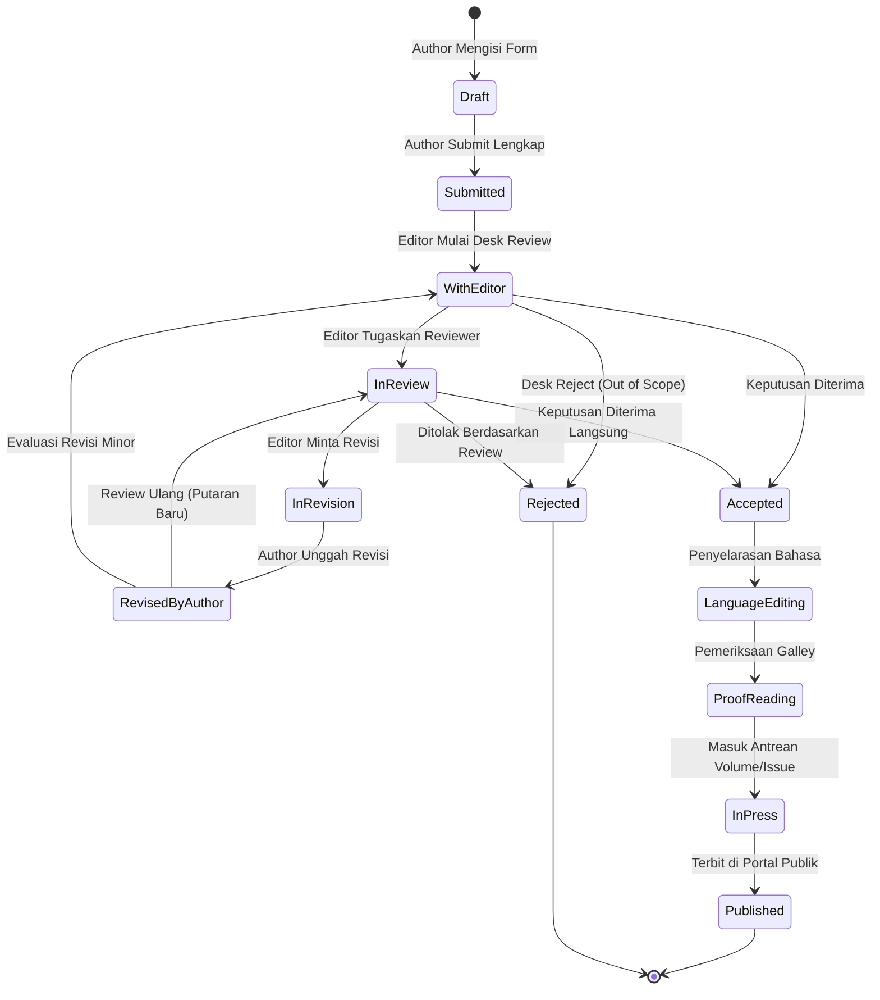
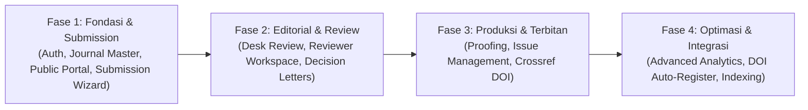

# 📄 Product Requirements Document (PRD) & Software Requirements Specification (SRS)
## Proyek: IGNITE — Scientific Publishing & Editorial Management Platform

---

### 📌 Ringkasan Dokumen
* **Nama Produk:** IGNITE (Integrated Genomic & Research Publishing System)
* **Organisasi Pemilik:** Yayasan Satriabudi Dharma Setia (YSDS)
* **Framework Dasar:** Laravel 12 (HMVC Modular Architecture via `nwidart/laravel-modules`)
* **Versi Dokumen:** 1.0 (Comprehensive Baseline)
* **Status Dokumen:** Siap Implementasi (Approved for Development)
* **Target Rilis MVP:** Q4 2026

---

## 1. Latar Belakang & Pernyataan Masalah (*Problem Statement*)

### 1.1 Latar Belakang
Program IGNITE di bawah naungan Yayasan Satriabudi Dharma Setia (YSDS) berfokus pada ekosistem riset biomedis, genomik, pendidikan kedokteran, penguatan jejaring laboratorium, dan kolaborasi institusional lintas sektor di Indonesia. Untuk mendukung diseminasi hasil riset dan transfer pengetahuan akademik secara kredibel dan mandiri, dibutuhkan platform terpadu yang memadukan portal publik institusi dan sistem manajemen penerbitan berkala ilmiah (*scientific journal & editorial workflow*).

### 1.2 Masalah yang Dihadapi (*The User Problem*)
1. **CMS Konvensional Tidak Memiliki Workflow Ilmiah:** Website berbasis CMS biasa (seperti WordPress) hanya berfungsi sebagai portal informasi statis dan tidak mampu memfasilitasi tata kelola *peer-review*, penugasan reviewer ganda, audit trail keputusan editor, maupun pelacakan versi naskah.
2. **Keterbatasan Fleksibilitas Platform OJS Standar:** Menggunakan platform monolitik lawas (seperti OJS versi standar) sering kali menyulitkan integrasi visual dengan identitas jenama (*branding*) modern IGNITE/YSDS, kustomisasi arsitektur modern (Tailwind v4, Metronic UI), dan integrasi basis data enterprise terpadu.
3. **Risiko Integritas & Transparansi Akademik:** Tanpa sistem yang memiliki aturan mesin status (*state machine*) yang kaku, dokumen riset rentan mengalami inkonsistensi versi naskah, kebocoran data pada *blind review*, atau hilangnya jejak keputusan editorial.

### 1.3 Dampak Jika Tidak Diselesaikan (*Cost of Inaction*)
Ketiadaan platform penerbitan yang terstandarisasi menghambat akreditasi jurnal ilmiah institusi, memperlambat siklus peninjauan naskah riset biomedis, menurunkan kepuasan peneliti/penulis, dan menyulitkan pengindeksan global (Google Scholar, Crossref DOI, DOAJ, SINTA).

---

## 2. Tujuan & Indikator Keberhasilan (*Goals & Success Metrics*)

### 2.1 Tujuan Produk (*Product Goals*)
1. Menyediakan **portal publik ilmiah** yang cepat, responsif, dan elegan untuk menampilkan jurnal, edisi (*issues*), dan artikel terbitan lengkap dengan unduhan PDF dan sitasi otomatis.
2. Menyediakan **dashboard editorial modular** yang memandu naskah melalui seluruh siklus hidup: *Submission → Desk Review → Peer Review → Revision → Acceptance → Language Editing → Proofreading → Publication*.
3. Menjamin **keamanan dan kepatuhan akademik** melalui audit log tanpa jeda (*tamper-evident audit trail*), manajemen peran berbasis izin (RBAC granular), dan otentikasi multi-faktor (2FA).

### 2.2 Metrik Keberhasilan (*Success Metrics*)

| Tipe Metrik | Indikator | Target Sasaran | Cara Pengukuran |
| :--- | :--- | :--- | :--- |
| **Leading** (Cepat terlihat) | Kecepatan Naskah Masuk (*Submission Completion*) | > 85% draf berhasil disubmit tanpa kendala form wizard | Log status `draft` ke `submitted` |
| **Leading** | Waktu Respon Reviewer | Rata-rata < 72 jam untuk konfirmasi terima/tolak undangan | Selisih waktu undangan dikirim vs respons di `reviewer_assignments` |
| **Leading** | Performa Web Publik (*Core Web Vitals*) | Skor LCP < 1.5 detik, TTFB < 200 ms | Pengujian Lighthouse & Laravel Pulse |
| **Lagging** (Jangka panjang) | Siklus Review Naskah (*Turnaround Time*) | Penurunan durasi review dari submit s/d keputusan pertama < 21 hari kerja | Log riwayat `submission_histories` |
| **Lagging** | Keberhasilan Pengindeksan Sitasi | 100% artikel terbit memiliki metadata Crossref XML valid | Validasi skema Crossref & Google Scholar meta crawler |
| **Lagging** | Kepuasan Penulis & Reviewer | Skor CSAT/NPS > 4.5/5.0 pada survei pasca-review | Survei berkala pengguna aktif |

---

## 3. Batasan & Ruang Lingkup Luar (*Non-Goals*)

Fitur-fitur berikut secara eksplisit **BUKAN merupakan target fase MVP (v1)** guna mencegah *scope creep* dan menjaga kestabilan inti sistem:
1. **Integrasi Langsung API Plagiarism Checker Berbayar (Turnitin/iThenticate):** Pada v1, skor orisinalitas diinput secara manual oleh editor dan file hasil cek diunggah sebagai berkas lampiran pendukung.
2. **Sistem Pembayaran / Payment Gateway Biaya Pemrosesan Artikel (APC):** Penanganan biaya cetak atau APC dilakukan melalui invoice manual administratif di luar payment gateway otomatis.
3. **Konversi Dokumen Otomatis XML/JATS Kompleks:** Format terbitan artikel utama pada fase pertama difokuskan pada berkas **PDF Galley** beresolusi tinggi dan landing page metadata berbasis web.
4. **Single Sign-On (SSO) Federasi Kampus Internasional (eduGAIN/SAML):** Fase pertama memprioritaskan autentikasi email terverifikasi lokal, Google OAuth (jika diaktifkan), dan 2FA TOTP.

---

## 4. Analisis Pengguna & Matriks Peran (*User Personas & RBAC Matrix*)

Sistem menggunakan kontrol akses granular berbasis pustaka `spatie/laravel-permission`:

| No | Peran (*Role*) | Deskripsi & Tugas Utama | Batasan Akses Kunci |
| :---: | :--- | :--- | :--- |
| **1** | **Super Admin** | Konfigurasi platform server, manajemen modul, pengaturan global CMS, dan pemeliharaan sistem. | Tidak mengambil keputusan ilmiah jurnal kecuali diberi peran ganda. |
| **2** | **Journal Manager** | Mengatur master data jurnal, nomor ISSN/e-ISSN, susunan dewan editor, kebijakan fokus/skop, dan pembuatan issue. | Mengelola operasional jurnal tanpa hak override keputusan review independen. |
| **3** | **Editor in Chief** | Penanggung jawab ilmiah tertinggi jurnal; menetapkan keputusan final naskah (*Accept/Reject*) dan penunjukan Section Editor. | Memiliki wewenang mutlak pada jurnal yang dinaunginya. |
| **4** | **Section Editor / Handling Editor** | Melakukan *desk review* awal, mengundang reviewer sejawat, memonitor tenggat, dan mengajukan rekomendasi naskah. | Dilarang menilai naskah jika terdapat konflik kepentingan (*COI*). |
| **5** | **Reviewer** | Memberikan masukan ilmiah, rubrik evaluasi, dan rekomendasi melalui antarmuka khusus reviewer. | Hanya dapat melihat naskah yang ditugaskan; tidak dapat melihat identitas reviewer lain. |
| **6** | **Author (Penulis)** | Mendaftarkan akun, mengirim naskah baru, mengunggah revisi, dan memantau status transisi artikel. | Hanya dapat melihat naskah miliknya; tidak dapat melihat catatan rahasia editor. |
| **7** | **Language Editor / Copyeditor** | Menyelaraskan tata bahasa, konsistensi istilah biomedis/ilmiah, dan format kepenulisan. | Aktif setelah naskah berstatus `Accepted`. |
| **8** | **Proofreader** | Melakukan verifikasi tata letak akhir dan kesalahan tipografi pada galley sebelum terbit. | Tidak memiliki hak mengubah keputusan substansi akademik. |
| **9** | **Production Admin** | Menyiapkan berkas terbitan PDF/HTML, memasukkan nomor halaman, dan menjadwalkan artikel ke issue aktif. | Bekerja pada tahap pasca-akseptasi hingga naskah siap cetak. |
| **10**| **Reader (Publik)** | Membaca naskah publik, mengunduh file PDF terbitan, menyalin sitasi artikel, dan mencari arsip. | Tanpa akses login dashboard editorial. |

---

## 5. Alur State Machine Naskah (*Submission Lifecycle Specification*)

Naskah ilmiah diwajibkan mengikuti aturan transisi status yang valid sesuai diagram state machine berikut:

### Aturan Bisnis & Validasi Transisi (*Transition Invariants*):
1. **Draft → Submitted:** Wajib mengisi abstrak, minimal 3 kata kunci, mengunggah naskah utama, dan mengisi data minimal satu *Corresponding Author*.
2. **Submitted → With Editor:** Terjadi otomatis atau manual saat Section Editor ditugaskan oleh Editor in Chief.
3. **With Editor → In Review:** Wajib memiliki minimal **2 reviewer aktif** yang telah menerima (*accepted*) undangan review.
4. **In Review → In Revision:** Wajib menyertakan surat keputusan editorial resmi dan butir-butir masukan yang dapat dibaca oleh penulis.
5. **In Press → Published:** Wajib terhubung dengan entitas `Issue` yang aktif dan memiliki nomor halaman/identifikasi terbitan yang valid.

---

## 6. Spesifikasi Persyaratan Fungsional (*Functional Requirements*)

### 6.1 Modul 1: Autentikasi & Akun Pengguna (`Modules/Authentication` & `Usermanagement`)
* **FR-01.1 (P0 - Must Have):** Sistem harus mendukung registrasi mandiri untuk Author dan pembaca dengan validasi email aktif.
* **FR-01.2 (P0 - Must Have):** Sistem wajib menyediakan fitur Two-Factor Authentication (2FA) berbasis TOTP (Google Authenticator) bagi peran Editor, Reviewer, dan Administrator.
* **FR-01.3 (P0 - Must Have):** Sistem harus mencatat waktu login, IP address, dan user-agent pengguna pada tabel aktivitas.
* **FR-01.4 (P1 - Should Have):** Sistem menyediakan opsi delegasi profil reviewer dengan minat bidang keahlian (*areas of expertise* / keywords).

### 6.2 Modul 2: Manajemen Jurnal & Master Data (`Modules/Journals` & `Basicdata`)
* **FR-02.1 (P0 - Must Have):** Sistem mendukung pengelolaan multi-jurnal di mana masing-masing jurnal memiliki slug URL, deskripsi skop, nomor p-ISSN/e-ISSN, dan pedoman kepenulisan (*Author Guidelines*).
* **FR-02.2 (P0 - Must Have):** Sistem harus menyediakan antarmuka konfigurasi dewan editor (*Editorial Board*) per jurnal dengan pembagian seksi/bidang.
* **FR-02.3 (P1 - Should Have):** Sistem menyediakan master wilayah dinamis (Provinsi, Kota, Kecamatan) untuk verifikasi afiliasi institusi peneliti di Indonesia.

### 6.3 Modul 3: Portal Publik & Detail Artikel (`Modules/Website` & `Issues`)
* **FR-03.1 (P0 - Must Have):** Halaman depan menampilkan profil IGNITE/YSDS, daftar jurnal terbitan, artikel terbaru (*Latest Articles*), dan pengumuman.
* **FR-03.2 (P0 - Must Have):** Halaman arsip (*Archives*) menyajikan edisi terbitan per tahun dan volume/nomor terbitan.
* **FR-03.3 (P0 - Must Have):** Halaman detail artikel menyajikan judul, abstrak dwibahasa (ID/EN), daftar penulis beserta afiliasi dan surel korespondensi, tanggal submit/accepted/published, tombol unduh berkas PDF, serta generator sitasi (format APA, Harvard, IEEE, BibTeX).
* **FR-03.4 (P1 - Should Have):** Halaman publik menyematkan tag meta standar akademik (*Dublin Core* dan *Google Scholar Tags*) pada head HTML untuk mempermudah perayapan mesin pengindeks.

### 6.4 Modul 4: Wizard Pengajuan Naskah (*Submission Wizard*) (`Modules/Submissions`)
* **FR-04.1 (P0 - Must Have):** Form pengajuan naskah bertahap (*multi-step wizard*) untuk Author:
  * **Langkah 1 (Jurnal & Checklist):** Pemilihan jurnal tujuan dan persetujuan pernyataan etika/kebijakan orisinalitas.
  * **Langkah 2 (Metadata):** Judul artikel, abstrak (maksimal 250 kata), dan 3-6 kata kunci.
  * **Langkah 3 (Penulis Tambahan):** Penambahan multi-penulis (*co-authors*) dengan penandaan *Corresponding Author* utama.
  * **Langkah 4 (Unggah Berkas):** Pengunggahan naskah utama (*Manuscript File*), berkas anonymized untuk blind review, dan file lampiran pendukung (*Supplementary Files*).
  * **Langkah 5 (Konfirmasi & Finalisasi):** Ringkasan pengajuan sebelum naskah resmi diserahkan.
* **FR-04.2 (P0 - Must Have):** Validasi tipe berkas unggahan: hanya menerima `.docx`, `.doc`, atau `.pdf` dengan ukuran maksimal 25 MB per berkas.

### 6.5 Modul 5: Alur Kerja Editorial & Reviewer (`Modules/Submissions`)
* **FR-05.1 (P0 - Must Have):** Editor Workspace menyajikan dashboard peninjauan naskah masuk, filter naskah tertunda (*overdue reviews*), dan ringkasan putaran review (*Review Rounds*).
* **FR-05.2 (P0 - Must Have):** Sistem mampu mengirimkan email undangan penelaahan naskah kepada reviewer yang berisi token persetujuan aman (*Accept/Decline Invitation*).
* **FR-05.3 (P0 - Must Have):** Reviewer Workspace menyediakan formulir evaluasi terstruktur:
  * Penilaian aspek orisinalitas, metodologi riset, kualitas data genomik/laboratorium, dan kejelasan penulisan.
  * Opsi rekomendasi resmi: *Accept as is*, *Minor Revisions*, *Major Revisions*, *Reject*.
  * Kolom catatan masukan untuk Penulis (*Comments for Author*).
  * Kolom catatan rahasia untuk Editor (*Confidential Comments for Editor*).
* **FR-05.4 (P0 - Must Have):** Penanganan putaran revisi (*Revision Rounds*): penulis mengunggah versi perbaikan beserta dokumen jawaban tanggapan per poin (*Response to Reviewers*).

### 6.6 Modul 6: Produksi & Publikasi Terbitan (`Modules/Issues`)
* **FR-06.1 (P0 - Must Have):** Naskah berstatus `Accepted` dialihkan ke antrean produksi untuk tahap *Language Editing* dan *Proofreading*.
* **FR-06.2 (P0 - Must Have):** Production Editor dapat mengunggah berkas galley PDF akhir dan menetapkan nomor halaman naskah (*page start - page end*).
* **FR-06.3 (P0 - Must Have):** Fungsi penjadwalan penerbitan artikel ke dalam *Issue* (Volume, Nomor, Tahun, Bulan Publikasi).
* **FR-06.4 (P1 - Should Have):** Generator berkas ekspor metadata XML Crossref sesuai skema resmi untuk proses pendaftaran DOI massal.

### 6.7 Modul 7: Notifikasi & Audit Log (`Modules/Logs`)
* **FR-07.1 (P0 - Must Have):** Notifikasi otomatis via antrean email (Laravel Queue) untuk event kritis: naskah diterima, penugasan reviewer, pengingat batas waktu (*reminder overdue*), dan surat keputusan.
* **FR-07.2 (P0 - Must Have):** Pencatatan riwayat audit lengkap (*who, what, when, old values, new values*) untuk setiap perubahan status naskah atau pengunggahan berkas revisi menggunakan `spatie/laravel-activitylog`.

---

## 7. Persyaratan Non-Fungsional (*Non-Functional Requirements / NFR*)

### 7.1 Performa & Kecepatan (*Performance*)
* Waktu respons server (TTFB) untuk halaman portal publik artikel tidak boleh melebihi **200 ms** pada kondisi *traffic* normal.
* Pemuatan aset CSS dan Javascript dikompilasi menggunakan Vite v7 dengan ukuran bundel teroptimasi dan *tree-shaking*.
* Seluruh kueri basis data pada DataTables wajib menerapkan paginasi *server-side* dan *eager loading* (`with(['journal', 'author'])`) untuk mencegah masalah kueri N+1.

### 7.2 Keamanan & Integritas (*Security*)
* **Proteksi CSRF & XSS:** Seluruh formulir dan request manipulasi data wajib divalidasi token CSRF dan dilakukan sanitasi input ketat via Form Request.
* **Otentikasi & Manajemen Sesi:** Password wajib di-hash menggunakan algoritma Bcrypt/Argon2ID. Sesi dibatasi maksimal 120 menit tidak aktif (*inactivity timeout*).
* **Penyimpanan Berkas Terisolasi:** Berkas naskah dalam tahap review disimpan pada storage privat terproteksi dan hanya dapat diunduh melalui endpoint controller berotorisasi, bukan tautan publik langsung.
* **Firewall & Rate Limiting:** Endpoint autentikasi diproteksi pembatasan frekuensi (*rate-limiting*) maksimal 5 percobaan gagal per menit serta hardening firewall CSF/LFD.

### 7.3 Skalabilitas & Keandalan (*Reliability & Availability*)
* Arsitektur backend mendukung containerization penuh via Docker Compose (App, Nginx, PostgreSQL, Redis, Queue Worker, Scheduler).
* Email notifikasi dan proses pembuatan dokumen diproses di latar belakang (*background workers*) menggunakan Redis queue agar tidak membebani alur HTTP utama.
* Skema basis data mendukung *SoftDeletes* pada seluruh data relasional untuk mencegah kehilangan histori tanpa sengaja.

### 7.4 Kepatuhan Standar Akademik (*Academic Compliance*)
* Desain alur peer-review mengacu pada panduan etika publikasi internasional COPE (*Committee on Publication Ethics*).
* Struktur metadata naskah mendukung pemetaan Dublin Core dan OpenURL untuk menjamin keterbacaan oleh mesin pengindeks Google Scholar, Crossref, dan Garuda/SINTA.

---

## 8. Skenario Pengujian Kritis (*Acceptance Criteria / Given-When-Then*)

### Skenario 1: Penulis Menyelesaikan Pengajuan Naskah
* **GIVEN:** Penulis (*Author*) telah login dan mengisi seluruh form metadata, penulis pendamping, dan berkas naskah utama.
* **WHEN:** Penulis mengklik tombol "Kirim Naskah (Submit Manuscript)".
* **THEN:** Status naskah berpindah dari `draft` ke `submitted`, nomor unik naskah dibuat, surel konfirmasi terkirim ke penulis, dan notifikasi naskah masuk tampil di inbox Editor in Chief.

### Skenario 2: Penugasan & Evaluasi Reviewer
* **GIVEN:** Naskah berada pada status `with_editor` dan Editor telah memilih 2 orang Reviewer.
* **WHEN:** Editor mengklik "Kirim Undangan Review", dan kedua Reviewer mengonfirmasi penerimaan penugasan.
* **THEN:** Status naskah berpindah menjadi `in_review`, tenggat waktu review ditetapkan, dan reviewer mendapatkan akses untuk mengunduh naskah anonymized serta mengisi rubrik penilaian.

### Skenario 3: Penerbitan Artikel ke Publik
* **GIVEN:** Naskah telah melewati tahap `accepted`, `language_editing`, dan `proofreading`, serta telah dimasukkan ke dalam Issue yang berstatus `published`.
* **WHEN:** Production Editor memublikasikan issue tersebut.
* **THEN:** Status artikel menjadi `published`, artikel tampil di daftar isi website publik, berkas PDF galley dapat diunduh oleh umum, dan metadata sitasi dapat diakses secara terbuka.

---

## 9. Rencana Fase Implementasi & Roadmap (*Implementation Phasing*)

* **Fase 1 (Fondasi & Pengajuan Naskah - Minggu 1 s/d 4):**
  * Penuntasan RBAC 10 peran dan otentikasi 2FA TOTP.
  * Master data Jurnal, Edisi (*Issues*), dan Dewan Editor.
  * Website publik responsif berbasis TailwindCSS v4.
  * Multi-step Submission Wizard untuk Penulis.
* **Fase 2 (Mesin Editorial & Peer Review - Minggu 5 s/d 8):**
  * Dashboard inbox Editor dan penugasan Section Editor.
  * Reviewer Workspace dan form rubrik evaluasi.
  * Siklus revisi naskah (*Revision Rounds*) dan log riwayat naskah.
* **Fase 3 (Manajemen Produksi & Penerbitan - Minggu 9 s/d 12):**
  * Alur Language Editing dan Galley Proofreading.
  * Penjadwalan artikel ke Volume/Issue dan penguncian naskah terbit.
  * Ekspor metadata XML Crossref dan generator sitasi.
* **Fase 4 (Penyempurnaan & Observabilitas - Minggu 13 s/d 16):**
  * Pemantauan performa real-time via Laravel Pulse & Telescope.
  * Pengetesan menyeluruh (*End-to-End Testing* & UAT Editorial).
  * Penyusunan User Manual per peran pengguna.

---

## 10. Daftar Pertanyaan Terbuka & Mitigasi Risiko (*Open Questions & Risks*)

| No | Isu / Pertanyaan Terbuka | Pihak Terkait | Dampak | Rencana Mitigasi |
| :---: | :--- | :--- | :--- | :--- |
| 1 | Apakah model review yang diberlakukan *Single-Blind* atau *Double-Blind* secara default? | Tim Editorial / Kebijakan Jurnal | Tinggi | Sistem dirancang mendukung konfigurasi per jurnal (*configurable per journal*) dengan penyediaan berkas naskah terpisah tanpa identitas penulis. |
| 2 | Apakah akun Reviewer baru dapat diundang dari luar sistem melalui surel? | Tim Engineering | Sedang | Sediakan tautan undangan berkunci token aman yang mengizinkan aktivasi akun instan saat undangan disetujui. |
| 3 | Kapan integrasi akun pendaftaran resmi Crossref DOI dihubungkan langsung? | Pimpinan YSDS / Legal | Sedang | Sediakan ekspor berkas XML Crossref secara manual terlebih dahulu sebelum menggunakan REST API deposit otomatis. |

---
*Dokumen ini merupakan acuan tunggal (*single source of truth*) fungsional dan teknis untuk perancangan, implementasi, dan pengujian sistem IGNITE.*
